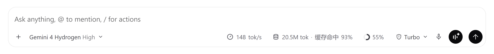
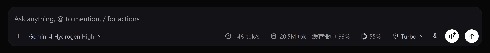
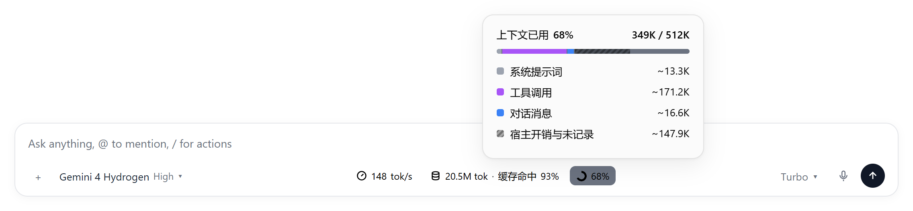
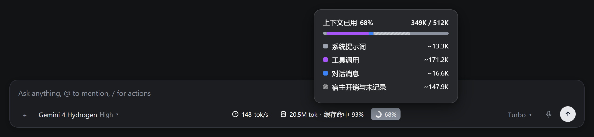
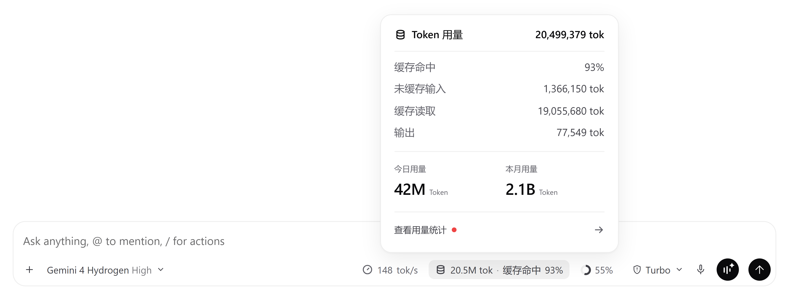
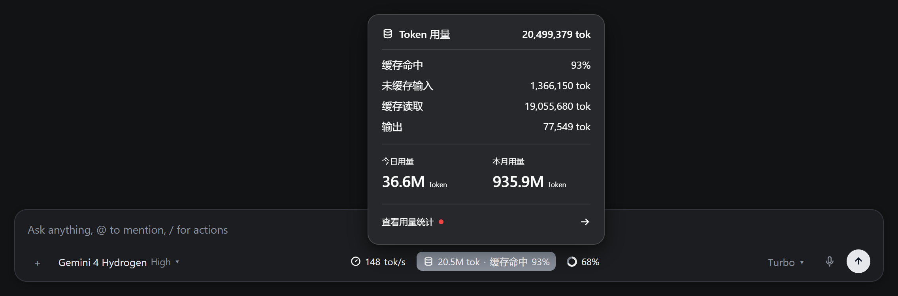
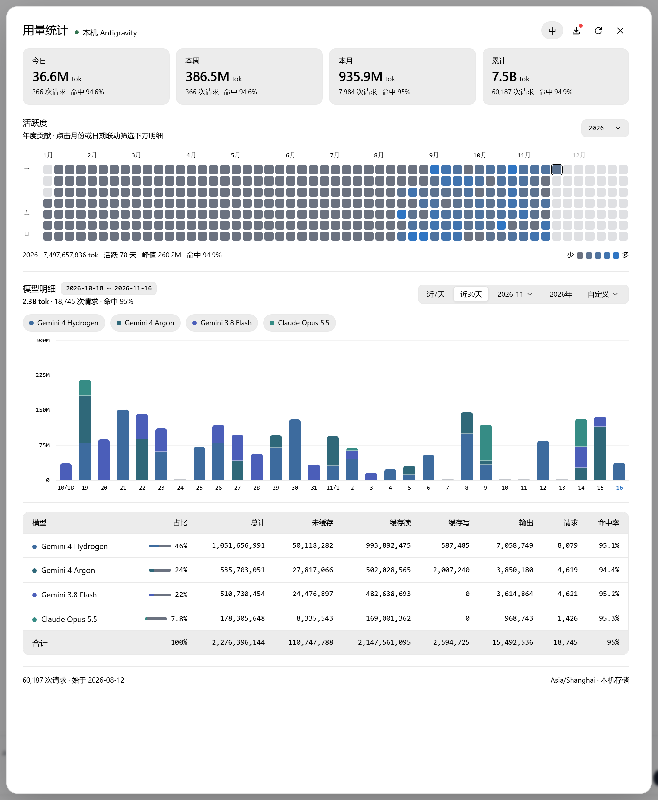
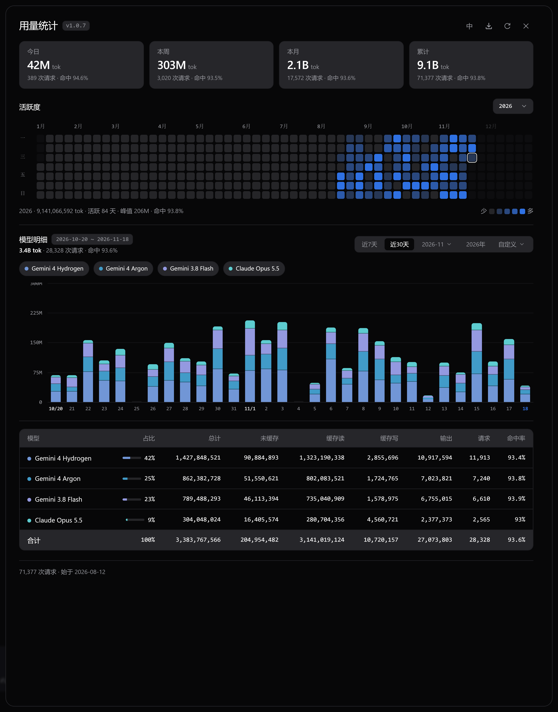
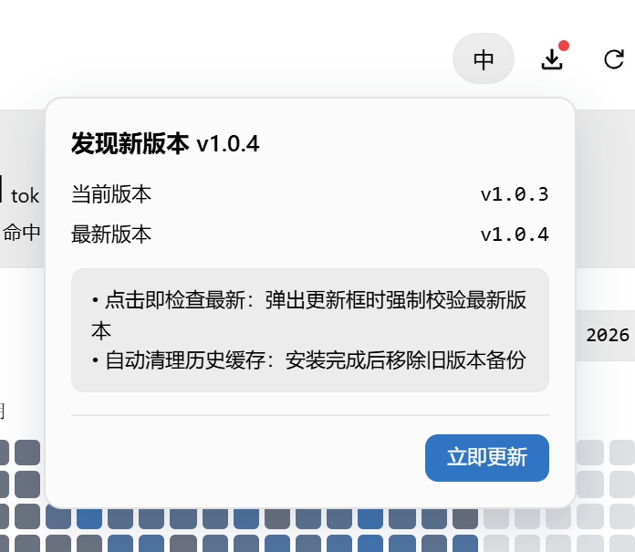
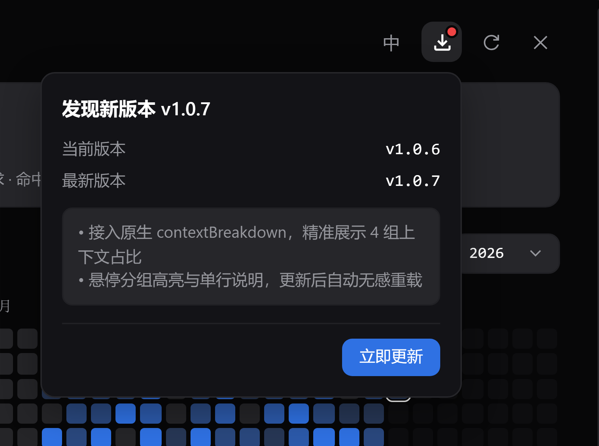

<div align="center">


# Antigravity Context

[简体中文](README.md) · **English**

A lightweight, local-first Antigravity plugin that injects an inline context window & telemetry bar into the chat composer and provides an interactive Token usage analytics modal.

[MIT License](LICENSE) · Version `v1.0.4` · [Changelog](CHANGELOG.en.md)

</div>

---

## Screenshots (Light & Dark Themes)

### 1. Inline Composer Status Bar
Embedded directly inside the chat composer footer to display **generation speed (`tok/s`), session tokens & cache hit rate, and the context ring indicator**:

**Light Theme**


**Dark Theme**


### 2. Context Window Breakdown Popover
Hover or click the context indicator to inspect active window capacity and token breakdown (**System prompt, Tool calls, Messages, Host overhead & other**):

**Light Theme**


**Dark Theme**


### 3. Token & Cache Details Popover
Hover or click the token chip to inspect cache hit rate, uncached input, cache read, output tokens, and **Today / This month** totals (displays a red notification dot when an update is ready):

**Light Theme**


**Dark Theme**


### 4. Usage Analytics Modal (Activity Heatmap & Model Breakdown)
Click "View usage stats" to open the standalone analytics modal featuring unified date filters (**7d / 30d / Month / Year / Custom**) cross-linked with the yearly contribution heatmap, stacked bar chart, and model breakdown table:

| Light Theme | Dark Theme |
| --- | --- |
|  |  |

### 5. Online Update Check & Install Popover
Click the top-right update button (with a red notification dot when an update is available) to fetch the latest GitHub release, preview clean release notes, and install with SHA-256 verification:

| Light Theme | Dark Theme |
| --- | --- |
|  |  |

---

## Key Features

- **Inline Context Bar**: Real-time context window occupancy (`0` / `0%` on empty new conversations), prioritizing server-reported actual tokens from the latest request, with compaction-aware recalculation and overflow alerts.
- **Unified Single-Page Usage Analytics**: Aggregates local desktop history with cross-conversation deduplication, yearly contribution heatmap, per-model stacked bar chart, and a 9-column model breakdown table with interactive month/day drilldown.
- **Headless Background Sidecar**: Removed the redundant right-side auxiliary pane web dashboard (`has_web_ui: false`); runs purely as a headless background collector and local CDP inline injector.
- **Auto Update Check & Online Install**: Automatically checks GitHub Releases silently on startup and every 6 hours; displays a **red dot badge** on the top-right update button of the usage analytics modal (and on the modal entry link) when a new release is available, with SHA-256 verified online download, atomic install, and reload (requires Python 3.10+).
- **Host-Adaptive Theme & Multilingual UI**: Dynamically mirrors Antigravity light/dark CSS variables and fonts; supports instant switching between **English, Simplified Chinese (`zh-CN`), and Traditional Chinese (`zh-TW`)**.
- **Cross-Platform**: Works on Windows, macOS, and Linux.

---

## Installation

Clone this repository directly into your Antigravity plugins directory (`antigravity-context`):

```bash
git clone https://github.com/1swei/antigravity-context.git ~/.gemini/config/plugins/antigravity-context
```

On Windows PowerShell:

```powershell
git clone https://github.com/1swei/antigravity-context.git "$env:USERPROFILE\.gemini\config\plugins\antigravity-context"
```

Then enable **Antigravity Context** in Antigravity's Plugin Manager (or reload the window).

---

## Testing

Requires Node.js >= 20:

```bash
node --check sidecars/panel/main.mjs
node --test sidecars/panel/tests/*.test.mjs
```

---

## Origin & License

This project is a derivative fork based on the MIT-licensed `antigrative-dashboard` (`antigravity-pulse` v0.8.20 baseline) originally created by `YOU-SHOULD-KNOW-ME`. The original upstream GitHub repository (`https://github.com/YOU-SHOULD-KNOW-ME/antigrative-dashboard`) is no longer available (HTTP 404).

Licensed under the [MIT License](LICENSE). See [Changelog (English)](CHANGELOG.en.md) · [更新日志 (中文)](CHANGELOG.md) for details.
