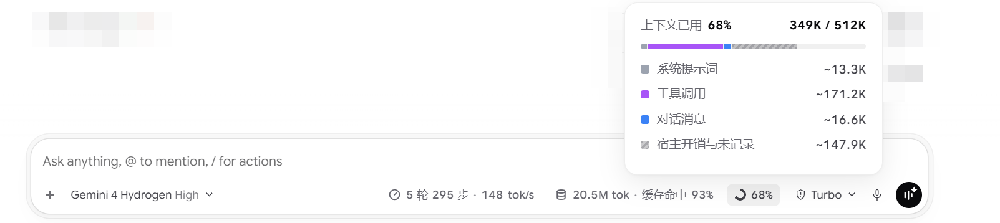
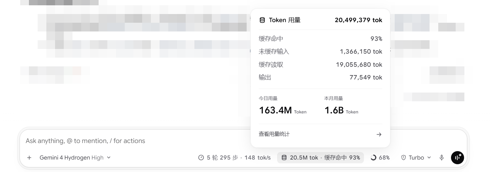
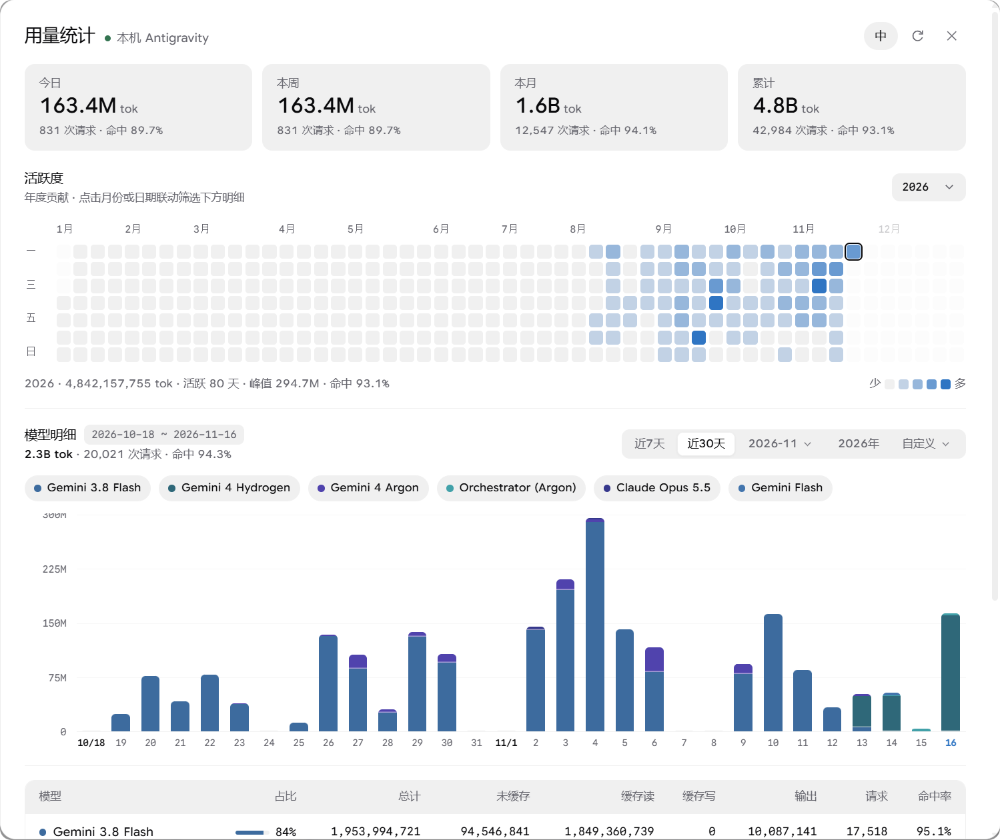

<div align="center">


# Antigravity Context

**简体中文** · [English](README.en.md)

轻量、本地优先的 Antigravity 插件：在对话输入框内直接展示实时上下文占用、分段构成、生成速度、缓存命中率，并提供交互式 Token 用量统计弹窗。


</div>

---

## 界面预览

### 1. 输入框内联状态栏
直接在对话输入框底部嵌入紧凑指标条，实时展示 **轮次/步数、生成速度（tok/s）、会话 Token 与缓存命中率、上下文占用环形进度**：


### 2. 上下文占比与分段构成拆解
悬停或点击上下文百分比，即可查看当前窗口总容量及分段估算（**系统提示词、工具调用、对话消息、宿主开销与未记录**）：



### 3. Token 与缓存明细浮层
悬停或点击 Token 指标条，查看本次会话缓存命中率、未缓存输入、缓存读取、输出及 **今日 / 本月用量**：



### 4. 用量统计弹窗（年度热力图 + 模型明细）
点击「查看用量统计」打开独立统计弹窗，支持 **近7天 / 近30天 / 按月 / 按年 / 自定义区间** 统一筛选，并与年度贡献热力图、堆叠柱状图和模型明细表双向联动下钻：



---

## 核心特性

- **内联上下文条**：实时展示上下文窗口占用（新空会话诚实显示 `0` / `0%`），优先使用服务端最近一次请求的实际 Token，支持压缩后容量重算与超限提示。
- **单页全联动用量统计**：汇总本地桌面端历史用量并跨会话去重，支持年度贡献热力图、模型对比柱状图与 9 列模型明细表（总计、未缓存、缓存读、缓存写、输出、请求、命中率），支持按月份/日期格子直接联动筛选。
- **无头后台运行**：已移除右侧辅助栏冗余 Web 看板（`has_web_ui: false`），后台仅通过受控本地 CDP 通道完成指标采集与状态栏注入。
- **自动更新检查与在线安装**：启动及后台每 6 小时自动静默检查 GitHub Releases 新版本；有新版本时在用量统计弹窗右上角「检查更新」按钮与统计入口处显示**红点提醒**，支持点击在线下载校验、原子替换安装与重载生效（需 Python 3.10+）。
- **宿主视觉融合 & 多语言**：自动跟随 Antigravity 浅色/深色主题变量与字体；内置 **简体中文 / 繁體中文 / English** 三语即时切换。
- **跨平台支持**：支持 Windows、macOS 与 Linux。

---

## 安装方式

将本仓库直接克隆到 Antigravity 的插件目录（目录名统一为 `antigravity-context`）：

```bash
git clone https://github.com/1swei/antigravity-context.git ~/.gemini/config/plugins/antigravity-context
```

Windows PowerShell：

```powershell
git clone https://github.com/1swei/antigravity-context.git "$env:USERPROFILE\.gemini\config\plugins\antigravity-context"
```

克隆完成后，在 Antigravity 插件管理中启用 **Antigravity Context**（或重新加载窗口）即可生效。

---

## 本地测试

需要 Node.js >= 20：

```bash
node --check sidecars/panel/main.mjs
node --test sidecars/panel/tests/custom-ui.test.mjs sidecars/panel/tests/runtime-ui.test.mjs sidecars/panel/tests/startup.test.mjs sidecars/panel/tests/usage.test.mjs sidecars/panel/tests/i18n.test.mjs sidecars/panel/tests/context.test.mjs sidecars/panel/tests/transcript.test.mjs
```

> 注：`sidecars/panel/tests/entry-usage.test.mjs` 中包含 1 条依赖宿主 `ide/main.mjs` 的 IDE 入口测试，独立插件包环境下该条会提示缺少 `ide/main.mjs`，其余 `app` 与 `preview` 测试用例均正常通过。

---

## 项目来源与开源协议

本项目基于原作者 `YOU-SHOULD-KNOW-ME` 发布的 MIT 开源项目 `antigrative-dashboard`（`antigravity-pulse` v0.8.20 基线）进行二次开发与自维护。原上游 GitHub 仓库（`https://github.com/YOU-SHOULD-KNOW-ME/antigrative-dashboard`）目前已失效（HTTP 404）。

### v1.0.0 主要改动
- 移除右侧辅助栏 Web 看板（`has_web_ui: false`、移除 `ui_config` 及看板前端源码），将 `sidecars/panel/main.mjs` 改造为纯无头后台采集与内联注入服务。
- 移除额度组（Quota）区块；恢复并升级更新机制（启动与后台定时自动检查更新、用量统计弹窗右上角红点提醒与在线校验安装）。
- 校准上下文占用统计（优先取最近请求的服务端真实 Token）、Transcript 构成解析（剔除压缩前历史、准确识别撤销/修订）及跨会话用量去重。
- 重构用量统计弹窗为单页统一日期筛选（`7d` / `30d` / `月` / `年` / `自定义`）并打通热力图与明细联动。
- 适配 Antigravity 宿主浅色/深色 CSS 变量与字体，重构插件展示名称（**Antigravity Context**）与矢量图标。

本项目采用 [MIT License](LICENSE) 开源，完整变更记录见 [更新日志 (中文)](CHANGELOG.md) · [Changelog (English)](CHANGELOG.en.md)。
